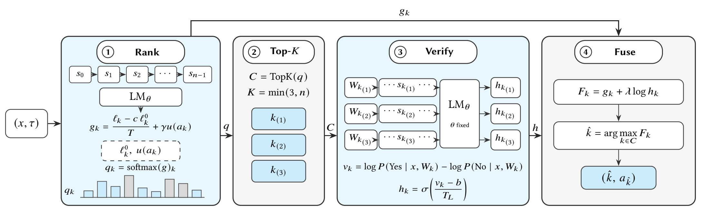

# SelectVerify

**Select, Then Verify: Budgeted Failure Attribution for Tool-Using Agents**

SelectVerify locates the decisive error in a failed agent execution trace using one frozen language model. It ranks steps globally, verifies at most three candidates in separate local contexts, and fuses their scores without generating an answer or rationale during attribution.

[](assets/framework.pdf)

[View the original vector figure (PDF)](assets/framework.pdf)

> **Status:** Exact checkpoint provenance, upstream revisions, licensing, and a fresh full GPU replication remain to be finalized. See [release metadata](src/selectverify/assets/release_manifest.json).

## Method

1. **Rank:** score valid step identifiers using a digit-prefix tree and a shared prompt KV cache. Optional content-free calibration and agent likelihoods adjust the global scores.
2. **Select:** keep the top three steps, or all steps when the trace has fewer than three.
3. **Verify:** independently score each candidate's local context with Yes/No logits.
4. **Fuse:** combine the global and local scores and return the chosen step and its agent.

**SV-Lite** omits position calibration and agent scoring, and uses first-event aggregation. Both variants use a frozen model; there is no model-training stage. Identifier scoring uses short teacher-forced forward passes, rather than sampled text generation.

The earlier **full-signal attributor** is a separate predecessor combining two global prompts, calibration, agent scores, and independent verification of every step. It is **not** the generative Step-by-Step baseline, nor simply SelectVerify with a larger candidate budget.

## Results on Who&When Pro

When is framework-macro step accuracy; Who is agent accuracy averaged over the five frameworks scored as multi-agent; micro-Step is pooled step accuracy. All accuracy values are percentages. Tokens and mean latency are per trajectory.

| Method | When | Who | micro-Step | Tokens | Mean (s) | P90 (s) |
| :--- | ---: | ---: | ---: | ---: | ---: | ---: |
| All-at-Once | 50.20 | 57.20 | 54.24 | 5,579 | 3.11 | 4.09 |
| MASPrism [1] | 31.32 | 51.07 | 28.60 | **2,945** | 1.73 | 3.78 |
| Binary Search | 34.45 | 27.89 | 38.98 | 6,641 | 1.27 | 3.49 |
| Full-signal attributor [2] | 58.46 | 60.15 | 61.65 | 22,352 | ~9.27 | ~18.71 |
| SV-Lite | 57.98 | 60.27 | 59.96 | 7,553 | **0.95** | **1.86** |
| **SelectVerify** | **62.40** | **61.92** | **64.62** | 10,890 | 1.49 | 3.21 |

| Decision rule | When | micro-Step | Mean (s) |
| :--- | ---: | ---: | ---: |
| Generate step only | 45.37 | 45.76 | 1.44 |
| Generate step + reason | 51.51 | 53.60 | 3.39 |
| Independent verification + score fusion (SV) | 62.40 | 64.62 | 1.49 |

## Quick start: inspect archived results

Requires **Python 3.10+**. No GPU, model weights, benchmark data, or upstream evaluator is needed for this path. Access to this private repository is required to clone it.

```bash
git clone https://github.com/Persiapinkman/selectverify.git
cd selectverify
python3.10 -m venv .venv
source .venv/bin/activate
python -m pip install -e '.[test]'
selectverify report --paper
python -m pytest -q
```

`report --paper` recomputes metrics from bundled sanitized per-example scores for `aao`, `best_dev`, `lean`, `binary_search`, `short`, and `reason`. It does **not** rerun inference. The optional PyTorch kernel tests are skipped when PyTorch is absent.

## Prepare a fresh experiment

### Dependencies and checkpoint

Python **3.10.20**, PyTorch **2.8.0+cu128**, Transformers **4.57.6**, BF16, SDPA, and a local verification batch size of **3**.

Install a PyTorch build compatible with your CUDA driver, followed by the inference and benchmark extras. For the archived CUDA 12.8 build:

```bash
python -m pip install torch==2.8.0 --index-url https://download.pytorch.org/whl/cu128
python -m pip install -e '.[inference,benchmark,test]'
```

### Benchmark

Obtain the official [Who&When Pro evaluator](https://github.com/whowhenpro/whowhen_pro) and [dataset](https://huggingface.co/datasets/Leoxx/whowhen_pro) separately, subject to their terms. Keep their exact revisions for reproduction. The evaluator revision used in the original archive remains to be pinned.

Set the following paths to your local copies; these are placeholders, not bundled assets:

```bash
export BENCHMARK_SOURCE="/path/to/whowhen_pro"
export DATA_ROOT="/path/to/whowhen_data"
export MODEL="/path/to/verified-checkpoint"
```

`BENCHMARK_SOURCE` must contain `whowhen_eval/`. `DATA_ROOT` must contain `data/text.jsonl` and `taxonomy.yaml`. `--benchmark-source` imports the renderer, parser, and scorer directly from that checkout; it does not install the upstream package or use its online model API.

```bash
selectverify check-data \
  --benchmark-source "$BENCHMARK_SOURCE" --data-root "$DATA_ROOT"
```


## Run the paired evaluation

Start with one development example per framework:

```bash
selectverify run \
  --benchmark-source "$BENCHMARK_SOURCE" --data-root "$DATA_ROOT" \
  --model "$MODEL" --split dev --per-framework 1 \
  --methods lean,best_dev,aao --output runs/dev-smoke.jsonl
```

Run the full evaluation using the bundled frozen configurations:

```bash
selectverify run \
  --benchmark-source "$BENCHMARK_SOURCE" --data-root "$DATA_ROOT" \
  --model "$MODEL" --split test --local-batch 3 \
  --methods lean,best_dev,aao --output runs/paired-test.jsonl
```

- `best_dev` is SelectVerify; `lean` is SV-Lite; `aao` is the official All-at-Once prompt.
- Each run produces prediction JSONL, a `.meta.json` sidecar, and a `.summary.json` report.
- The runner resumes completed `(id, method)` pairs only when experiment metadata matches. Use a new output path after changing the experiment; do not merge incompatible runs.
- CUDA timings cover prompt construction through prediction parsing, excluding model loading, label scoring, and disk writes. Token totals include non-padding input, teacher-forced suffixes, and generated output.
- Ground-truth labels stay outside the inference object. Outputs may contain generated text for baselines: inspect them before sharing. `runs/` is ignored by Git.

## Additional baselines and controls

Binary Search requires the upstream `Automated_FA/Lib/utils.py` from the original Who&When implementation. Supply a trusted, reviewed copy; the adapter extracts and executes its prompt-construction function.

```bash
selectverify run \
  --benchmark-source "$BENCHMARK_SOURCE" --data-root "$DATA_ROOT" \
  --model "$MODEL" --split test --methods binary_search \
  --binary-source /path/to/Agents_Failure_Attribution/Automated_FA/Lib/utils.py \
  --output runs/binary-test.jsonl
```

Run matched-candidate controls after completing the paired evaluation:

```bash
selectverify run \
  --benchmark-source "$BENCHMARK_SOURCE" --data-root "$DATA_ROOT" \
  --model "$MODEL" --split test --methods short,reason \
  --paired-source runs/paired-test.jsonl --output runs/controls-test.jsonl
```

The controls recompute global scores and require the fresh shortlist to match the source run. Their parser accepts supported integer, code-fenced, and boxed formats while enforcing candidate membership. The bundled sanitized scores omit candidate lists and generated text, so they cannot replace a fresh `--paired-source` file.

## Development selection and ablations

The frozen configurations are already included; rebuilding the search is optional and more expensive than Top-3 inference. To collect exhaustive signals and AAO predictions for both splits:

```bash
selectverify collect \
  --benchmark-source "$BENCHMARK_SOURCE" --data-root "$DATA_ROOT" \
  --model "$MODEL" --split all --output cache/signals.jsonl
selectverify run \
  --benchmark-source "$BENCHMARK_SOURCE" --data-root "$DATA_ROOT" \
  --model "$MODEL" --split all --methods aao \
  --output cache/all_at_once_4b.jsonl
selectverify screen \
  --benchmark-source "$BENCHMARK_SOURCE" --data-root "$DATA_ROOT" \
  --cache-dir cache --out-dir runs/selection
selectverify evaluate \
  --benchmark-source "$BENCHMARK_SOURCE" --data-root "$DATA_ROOT" \
  --cache-dir cache --out-dir runs/selection
```


## Repository layout

| Path | Purpose |
| :--- | :--- |
| `assets/framework.png`, `assets/framework.pdf` | README preview and original vector figure |
| `src/selectverify/algorithm.py` | Global scoring, shortlist selection, local fusion, metrics |
| `src/selectverify/likelihood.py` | Digit-prefix and teacher-forced agent likelihoods |
| `src/selectverify/prompts.py` | Global and local prompt construction |
| `src/selectverify/benchmark.py` | Label-isolated traces, manifest loading, official scoring adapter |
| `src/selectverify/inference.py`, `experiments.py` | Inference kernels and resumable experiment runner |
| `src/selectverify/binary.py`, `controls.py` | Binary Search adapter and matched-evidence controls |
| `src/selectverify/cached.py`, `report.py`, `cli.py` | Search, ablations, reporting, command-line interface |
| `src/selectverify/assets/` | Frozen configs, manifest, sanitized scores, release metadata |
| `tests/` | Algorithm, parser, prompt isolation, reporting, and synthetic kernel tests |

## Validation and release scope

Completed during packaging:

- 25 core tests and 3 separately executed synthetic CPU/PyTorch kernel tests passed.
- The official adapter recovered the 201/472 split.
- Development selection, frozen configs, and the cached ablation report matched the original archive exactly.
- An isolated wheel reproduced the bundled score summaries.

A fresh full GPU replication of this package has **not** been completed. Raw benchmark data, model weights, private deployment data, and experiment caches are not included. MASPrism and the full-signal predecessor still need standalone reproduction assets; CHIEF-no-G is outside this artifact's target paper version.

Before public release, confirm checkpoint provenance, pin upstream revisions, review third-party terms, complete GPU validation, and choose an appropriate license. 

## License and references

No project-wide open-source license has been selected yet; this README does not grant one. Third-party code, models, and datasets remain subject to their respective licenses.

This artifact accompanies **Select, Then Verify: Budgeted Failure Attribution for Tool-Using Agents**. Benchmark resources: [Who&When Pro evaluator](https://github.com/whowhenpro/whowhen_pro) and [dataset](https://huggingface.co/datasets/Leoxx/whowhen_pro).
